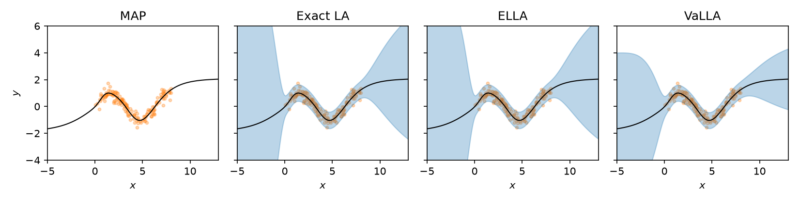

Exact linearized Laplace needs the full GGN of the network. That is fine for a
small MLP, but it does not scale. [ELLA](https://arxiv.org/abs/2210.12642) and [VaLLA](https://arxiv.org/abs/2302.12565) both
approximate the same linearized-Laplace GP in function space, so they work with
larger networks but using subsampled data. ELLA builds a low-rank Nyström basis from parameter Jacobians.
VaLLA fits a sparse variational GP with inducing points.

In this example we fit both to the sinusoidal regression task from the
[regression example](regression_example.md) and compare them with exact LA.
Both methods leave the network weights alone. You train a MAP network as usual
and fit the posterior afterwards.

```python
import torch

from laplace import Laplace

from helper.dataloaders import get_sinusoid_example

torch.manual_seed(711)
X_train, y_train, train_loader, X_test = get_sinusoid_example(sigma_noise=0.3)
```

## Training a MAP

Nothing new here. We train a single-hidden-layer Tanh network, reseeding first
so the initialization doesn't depend on the data sampling above:

```python
torch.manual_seed(711)
model = torch.nn.Sequential(
    torch.nn.Linear(1, 50), torch.nn.Tanh(), torch.nn.Linear(50, 1)
)

criterion = torch.nn.MSELoss()
optimizer = torch.optim.Adam(model.parameters(), lr=1e-2)
for i in range(1000):
    for X, y in train_loader:
        optimizer.zero_grad()
        loss = criterion(model(X), y)
        loss.backward()
        optimizer.step()
```

## Exact linearized Laplace

As a reference, we fit a full-GGN Laplace approximation. The network has only
151 parameters, so this is cheap.

We generated the data with noise \(\sigma = 0.3\), so we pass that value as
`sigma_noise` and only tune the prior precision. This assumes the aleatoric
noise is known. If it isn't, optimize the noise together with the prior
precision through the marginal likelihood, as in the
[regression example](regression_example.md).

```python
la = Laplace(
    model,
    "regression",
    subset_of_weights="all",
    hessian_structure="full",
    sigma_noise=0.3,
)
la.fit(train_loader)
la.optimize_prior_precision(method="marglik")
```

## ELLA

ELLA ([Deng, Zhou, and Zhu](https://arxiv.org/abs/2210.12642)) is selected
with `hessian_structure="gp"` and `functional_approximation="nystrom"`. During
`fit`, it draws `subsample_size` training inputs, computes the network's
parameter Jacobians on them, and keeps the top `n_eigenvalues` directions of
the resulting kernel as a Nyström basis. It then accumulates the GGN in that
basis over the full loader. Think of `subsample_size` as how much of the data
gets a say in the basis, and `n_eigenvalues` as how many directions you keep.
`n_eigenvalues` must be positive and at most `subsample_size`, which in turn
can't exceed the number of training rows.

We have 150 points, so 100 of them for the basis and a rank of 20 is plenty:

```python
ella = Laplace(
    model,
    "regression",
    subset_of_weights="all",
    hessian_structure="gp",
    functional_approximation="nystrom",
    subsample_size=100,
    n_eigenvalues=20,
    sigma_noise=la.sigma_noise.item(),
    prior_precision=la.prior_precision.item(),
)
ella.fit(train_loader)
```

If you ask for more directions than the sampled kernel actually has, `fit`
raises a `ValueError` that tells you the usable rank. That happens when the
subsample is too small or too redundant. Lower `n_eigenvalues`, raise
`subsample_size`, or try another seed.

The basis selection and the GGN accumulation each draw from the loader
separately. With a shuffling loader they may see different rows.
`ella.n_data` records how many examples went into the GGN.

We reuse the noise and prior precision from the exact LA, so ELLA's predictive
is directly comparable to it. The prior has to be a positive scalar precision
with zero mean. ELLA has no GP marginal likelihood, so to tune the prior
precision on its own you need held-out data:

```python
ella.optimize_prior_precision(method="gridsearch", val_loader=val_loader)
```

Passing validation data also makes `ella.fit_history_` record the validation
negative log likelihood next to the processed example counts.

## VaLLA

VaLLA ([Ortega, Rodríguez Santana, and
Hernández-Lobato](https://arxiv.org/abs/2302.12565)) takes a different route to
the same GP. Instead of a fixed basis, it places `num_inducing` inducing points
in input space and fits a variational posterior over the function values there.
It is selected with `functional_approximation="variational"`.

The inducing points need a starting position. `inducing_locations="random"`
picks them from the training inputs, and `"kmeans"` places them at k-means
centroids, which only works for floating-point tensor inputs. You can also pass
a tensor of locations yourself. Floating-point locations then move during
fitting. Integer tensors and mapping-style inputs stay where
you put them, and only the variational factor and hyperparameters are
optimized.

`alpha` picks the divergence that VaLLA minimizes. The default `alpha=1.0` is
the alpha-divergence objective from the paper, and `alpha=0.0` gives the usual
ELBO. Here we place 30 inducing points with k-means and fit the ELBO:

```python
valla = Laplace(
    model,
    "regression",
    subset_of_weights="all",
    hessian_structure="gp",
    functional_approximation="variational",
    inducing_locations="kmeans",
    num_inducing=30,
    alpha=0.0,
    sigma_noise=la.sigma_noise.item(),
    prior_precision=la.prior_precision.item(),
)
valla.fit(train_loader, iterations=3000, lr=1e-3)
```

Unlike ELLA, `fit` runs an optimizer over minibatches for `iterations` steps
at learning rate `lr`, with the network weights held fixed. It updates the
variational factor and the inducing locations. The prior precision and
observation noise from the exact LA are only starting values here, and the
optimizer tunes them too, which is why VaLLA doesn't need a separate
`optimize_prior_precision` call.

The objective at each step is in `valla.fit_history_["objective"]`. If the
curve hasn't flattened, keep going from where you stopped (the figure below
doesn't do this):

```python
valla.fit(train_loader, iterations=500, lr=1e-3, override=False)
```

Without `override=False`, a second `fit` starts the inducing points and
variational factor over, but keeps the learned prior precision and noise.

## Predictive

All three objects are called the same way. For regression they return the MAP
mean and the latent variance. Add the observation noise to get the predictive
variance of \(y\). For VaLLA, that is the noise it learned during fitting. The
figure shows the mean with a band of two predictive standard deviations:

```python
import matplotlib.pyplot as plt

x = X_test.flatten()
fig, axes = plt.subplots(1, 4, sharey=True, figsize=(11, 2.8))

def panel(ax, title, f_mu, f_var=None, sigma_noise=None):
    ax.set_title(title)
    ax.scatter(X_train.flatten(), y_train.flatten(), alpha=0.3, color="tab:orange", s=8)
    f_mu = f_mu.detach().flatten()
    ax.plot(x, f_mu, color="black", lw=1)
    if f_var is not None:
        std = (f_var.detach().flatten() + sigma_noise**2).sqrt()
        ax.fill_between(x, f_mu - 2 * std, f_mu + 2 * std, alpha=0.3, color="tab:blue")
    ax.set_xlim(x.min(), x.max())
    ax.set_xlabel("$x$")

with torch.no_grad():
    panel(axes[0], "MAP", model(X_test))

for ax, (name, posterior) in zip(
    axes[1:], [("Exact LA", la), ("ELLA", ella), ("VaLLA", valla)]
):
    panel(ax, name, *posterior(X_test), sigma_noise=posterior.sigma_noise.item())

axes[0].set_ylim([-4, 6])
axes[0].set_ylabel("$y$")
plt.tight_layout()
```



ELLA is very close to exact LA here. For a 1D problem and 151 parameters, a
rank-20 basis is apparently enough. Inside the data region, all three bands
stay close to the observation noise. Away from the data, VaLLA's bands are
wider than exact LA on the left and narrower on the right. It learned its own
prior precision and noise and works through 30 inducing points, so some
difference from exact LA is expected.

ELLA fits in a single pass with no optimizer, but you have to choose
`subsample_size` and `n_eigenvalues` yourself. VaLLA is more expensive to fit
and adds an optimization loop, and it learns its hyperparameters as it goes.

## Beyond regression

Both methods also handle classification and reward modeling, and the call
pattern stays the same. For classification, `posterior(x)` returns class
probabilities. For reward modeling, it returns a `(mean, covariance)` tuple for
the rewards of individual inputs, shaped `[batch, 1]` and `[batch, 1, 1]`, so
unpack it as you would in regression. VaLLA has
two classification-specific knobs. When you pass inducing locations yourself,
`inducing_classes` says which output each one belongs to (class 0 by default).
`mc_softmax_samples` switches the data term from the default probit
approximation to Monte Carlo sampling, and you need it for any `alpha` other
than 1.

If you need joint predictions across inputs, for instance for Bayesian
optimization, pass `joint=True` to `predictive_moments`,
`functional_samples`, or `predictive_samples`. The samples come back shaped
`[samples, batch, outputs]`. Neither method has weight-space `sample`, since
the posterior lives in function space.

To save a fitted posterior, use `state_dict` and `load_state_dict`. For ELLA
this stores the Nyström basis, and for VaLLA the inducing and variational
state. The checkpoint holds the posterior only, not the network. Load it into
a posterior built around the same pretrained model, with the same input keys,
curvature backend, backend options, and backpropagation setting.
`load_state_dict` checks that the model's weights and buffers match the
checkpoint. It also restores the seed, and for VaLLA the random-generator state
used in Monte Carlo fitting.

The full option list is in the [ELLA](api_reference/ella.md) and
[VaLLA](api_reference/valla.md) API reference.
`python -m examples.ella` and `python -m examples.valla` are minimal scripts
that fit each method and print the output shapes.
