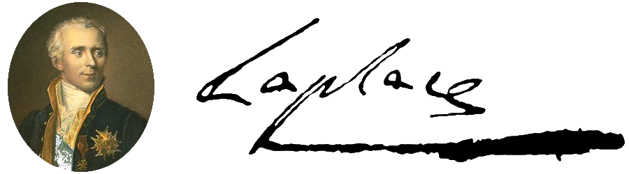

<div align="center">
 

</div>

The laplace package facilitates the application of Laplace approximations for entire neural networks, subnetworks of neural networks, or just their last layer.
The package enables posterior approximations, marginal-likelihood estimation, and various posterior predictive computations.
The library documentation is available at [https://aleximmer.github.io/Laplace](https://aleximmer.github.io/Laplace).

There is also a corresponding paper, [_Laplace Redux — Effortless Bayesian Deep Learning_](https://arxiv.org/abs/2106.14806), which introduces the library, provides an introduction to the Laplace approximation, reviews its use in deep learning, and empirically demonstrates its versatility and competitiveness. Please consider referring to the paper when using our library:

```bibtex
@inproceedings{laplace2021,
  title={Laplace Redux--Effortless {B}ayesian Deep Learning},
  author={Erik Daxberger and Agustinus Kristiadi and Alexander Immer
          and Runa Eschenhagen and Matthias Bauer and Philipp Hennig},
  booktitle={{N}eur{IPS}},
  year={2021}
}
```

The [code](https://github.com/runame/laplace-redux) to reproduce the experiments in the paper is also publicly available; it provides examples of how to use our library for predictive uncertainty quantification, model selection, and continual learning.

!!! important

    As a user, one should not expect Laplace to work automatically.
    That is, one should experiment with different Laplace's options
    (Hessian factorization, prior precision tuning method, predictive method, backend,
    etc!). Try looking at various papers that use Laplace for references on how to
    set all those options depending on the applications/problems at hand.

## Setup

To install laplace with `pip`, run the following:

```bash
pip install laplace-torch
```

The default backend, Curvlinops, is always installed. The ASDL and BackPACK
backends are optional extras:

```bash
pip install "laplace-torch[asdl]"      # AsdlGGN, AsdlEF, AsdlHessian
pip install "laplace-torch[backpack]"  # BackPackGGN, BackPackEF
pip install "laplace-torch[all]"       # both
```

Extras can be combined, e.g. `pip install "laplace-torch[asdl,backpack]"`.
Curvlinops currently depends on BackPACK, so a plain install still pulls it in.

The old `asdfghjkl` backend, which `LowRankLaplace` needs, is not on PyPI. Install it via:

```bash
pip install git+https://git@github.com/wiseodd/asdl@asdfghjkl
```

## Quickstart

### Simple usage

In the following example, a pre-trained model is loaded,
then the Laplace approximation is fit to the training data
(using a diagonal Hessian approximation over all parameters),
and the prior precision is optimized with cross-validation `"gridsearch"`.
After that, the resulting LA is used for prediction with
the `"probit"` predictive for classification.

!!! important

    Laplace expects all data loaders, e.g. `train_loader` and `val_loader` below,
    to be instances of PyTorch
    [`DataLoader`](https://pytorch.org/tutorials/beginner/basics/data_tutorial.html).
    Each batch, `next(iter(data_loader))` must either be the standard `(X, y)` tensors
    or a dict-like object containing at least the keys specified in
    `dict_key_x` and `dict_key_y` in Laplace's constructor.

!!! important

    The total number of data points in all data loaders must be accessible via
    `len(train_loader.dataset)`.

!!! important

    In `optimize_prior_precision`, make sure to match the arguments with
    the ones you want to pass in `la(x, ...)` during prediction.

```python
from laplace import Laplace

# Pre-trained model
model = load_map_model()

# User-specified LA flavor
la = Laplace(model, "classification",
             subset_of_weights="all",
             hessian_structure="diag")
la.fit(train_loader)
la.optimize_prior_precision(
    method="gridsearch",
    pred_type="glm",
    link_approx="probit",
    val_loader=val_loader
)

# User-specified predictive approx.
pred = la(x, pred_type="glm", link_approx="probit")
```

### Likelihoods

The `likelihood` argument takes a likelihood object, its name, or a PyTorch criterion, see the [likelihoods API](api_reference/likelihoods.md).
`likelihood="classification"` and `likelihood=CategoricalLikelihood()` give the same result.
`"bernoulli"` is for binary and multi-label targets: every output is a logit with its own sigmoid, and `nn.BCEWithLogitsLoss` is its loss.
The targets are floats with the shape of the outputs, and they may be soft labels in $[0, 1]$.
It takes the parametric structures (`diag`, `kron`, `full`) and the GLM and NN predictives.
The default `link_approx="probit"` is a closed form that applies the sigmoid to each logit scaled by its variance, and `"mc"` samples.
The Laplace bridge is for the softmax, so `"bridge"` and `"bridge_norm"` raise a `ValueError`.
Gridsearch uses `RunningBernoulliNLLMetric` by default.
See the [multi-label example](multilabel_example.py).

`"heteroscedastic_gaussian"` is for a network that predicts its own noise, trained with `nn.GaussianNLLLoss`.
The model returns the pair `(mean, var)`, and `la(x)` returns `f_mean, f_alea, f_epis`: the mean and the variance at the MAP, and the epistemic covariance of the mean.
The LA is over the mean only, with the variance held fixed, as in [Immer et al. (2023)](https://openreview.net/forum?id=A6EquH0enk).
It takes all weights or a subnetwork, but not the last layer, and the `diag`, `full`, and `kron` structures with the Curvlinops backends.
Gridsearch uses `RunningGaussianNLLMetric` by default.
See the [heteroscedastic regression example](heteroscedastic_example.py).

For classification, the targets are class indices `(batch, ...)` or class probabilities `(batch, ..., classes)`, as in `nn.CrossEntropyLoss`.
Class probabilities, such as one-hot or soft labels, must be floats. Integer one-hot targets raise a `ValueError` that asks for `.float()`.
Every position of a sequence is an observation, while the class dimension of probability targets is not.
See the [soft label example](soft_label_example.py).

#### Options

The built-in likelihoods take the options of the matching PyTorch criterion, with the same names, defaults, and meaning.
For example, `CategoricalLikelihood(weight, ignore_index, label_smoothing)` mirrors `nn.CrossEntropyLoss`, `BernoulliLikelihood(weight, pos_weight)` mirrors `nn.BCEWithLogitsLoss`, and `HeteroscedasticGaussianLikelihood(eps, full)` mirrors `nn.GaussianNLLLoss`.
The options of the Bernoulli likelihood are scalars or have one entry per output.
You can also pass the criterion you trained with.
Its `reduction` is ignored, since Laplace always sums the loss.

```python
from torch import nn
from laplace import Laplace

criterion = nn.CrossEntropyLoss(ignore_index=-100, label_smoothing=0.1)
la = Laplace(
    model,
    criterion,  # or CategoricalLikelihood(ignore_index=-100, label_smoothing=0.1)
    subset_of_weights="all",
    hessian_structure="diag",
)
la.fit(train_loader)
```

Some caveats:

- Not every curvature backend handles every option.
  With `diag` or `full` and a GGN or EF backend, Laplace falls back to its own, slower torch.func implementation when the library can't.
  `kron`, the Hessian backends, and the Monte Carlo Fisher (`stochastic=True`) raise a `ValueError` for the options they can't handle.
- Ignored targets, such as padding, don't count as observations and add nothing to the curvature, as in `nn.CrossEntropyLoss`.
  `kron` drops them from both Kronecker factors.
  A layer whose positions don't line up with the logits, such as a convolution before pooling, keeps all positions of an example in its input factor if the example has at least one observed target.
  A layer counts as lined up if it has as many positions as the logits, in the same order.
- The Bernoulli likelihood is known to Curvlinops only.
  BackPACK and ASDL fall back to the torch.func implementation for `diag` and `full`, and `kron` raises a `ValueError`.
  `LowRankLaplace` raises a `ValueError` as well.
- `kron` with a GGN or Monte Carlo Fisher backend raises a `ValueError` for the Bernoulli options `weight` and `pos_weight`, since Curvlinops' KFAC ignores them without a warning.
  This is tracked at [f-dangel/curvlinops#311](https://github.com/f-dangel/curvlinops/issues/311).
  `CurvlinopsEF` takes them with `kron`.
- Function-space methods (`hessian_structure="gp"`) don't support sequence outputs, and `ELLA` and `VaLLA` only accept the default `ignore_index=-100`.
  They leave out ignored rows, while `FunctionalLaplace` raises a `ValueError` if its sampled subset has any.
- `ELLA` and `VaLLA` take hard labels only. Class probabilities raise a `ValueError`.
  With the Bernoulli likelihood, they take float targets of the outputs' shape, and soft labels are fine.
- With the Bernoulli likelihood, `ELLA(balanced=True)` needs one output, and `VaLLA` places all its inducing points on output 0.
- Options that reweight or smooth the loss, such as class weights or label smoothing, make the likelihood a generalized one.
  `log_marginal_likelihood()` is then no longer the model evidence in the strict sense.

#### Custom likelihoods

To define your own likelihood, subclass `Likelihood`, set a `name`, and implement `distribution(f)`.
It returns the distribution of the targets given the model outputs `f` as a `torch.distributions.Distribution`.
Everything else has a default built on it, including the output Hessian, which is the Fisher of the distribution with respect to `f`.
For distributions with finite support, such as the Bernoulli or the categorical, the Fisher is computed exactly by enumerating the support.
For other distributions, it is a Monte Carlo estimate, and a warning says so.
If you know the Fisher in closed form, override `output_hessian` to make it exact and cheap.
The `Likelihood` docstring lists every member you can override.

```python
import torch
from laplace import Laplace, Likelihood

class PoissonLikelihood(Likelihood):
    name = "poisson"

    def distribution(self, f):
        return torch.distributions.Poisson(rate=f.exp())

    # Optional: with a log link, the Fisher is exp(f)
    def output_hessian(self, f, y=None):
        return torch.diag_embed(f.exp())

la = Laplace(model, PoissonLikelihood(),
             subset_of_weights="all", hessian_structure="diag")
la.fit(train_loader)
la.optimize_prior_precision()
rate = la(x, pred_type="glm", n_samples=1000)
```

Fit a custom likelihood with the `diag` or `full` structure and a GGN or EF backend.
For a Gaussian likelihood, the GLM predictive returns the moments of \(f\), and for classification it returns class probabilities.
For any other likelihood, it draws `n_samples` samples \(f \sim \mathcal{N}(f_\mu, \Sigma_f)\) from the GLM predictive and averages the `inverse_link` \(g\) over them, a Monte Carlo estimate of \(\mathbb{E}[g(f)]\).
`link_approx` has no effect there.
In the example above, the result is the expected Poisson rate.
Gridsearch has no default loss for a custom likelihood, so pass `loss` to `optimize_prior_precision`.
FunctionalLaplace, ELLA, and VaLLA raise a `ValueError` for custom likelihoods and `"heteroscedastic_gaussian"`.
FunctionalLaplace also accepts a `CategoricalLikelihood` or `BernoulliLikelihood` with options.
ELLA and VaLLA don't support likelihood options yet and raise a `ValueError` for them.

### Marginal likelihood

The marginal likelihood can be used for model selection [10] and is differentiable
for continuous hyperparameters like the prior precision or observation noise.
Here, we fit the library default, KFAC last-layer LA and differentiate
the log marginal likelihood.

```python
from laplace import Laplace

# Un- or pre-trained model
model = load_model()

# Default to recommended last-layer KFAC LA:
la = Laplace(model, likelihood="regression")
la.fit(train_loader)

# ML w.r.t. prior precision and observation noise
ml = la.log_marginal_likelihood(prior_prec, obs_noise)
ml.backward()
```

### Known noise per output

A regression network with several outputs can have a different noise std \(\sigma_k\)
for each output. If you know them, set the vector on the likelihood, before `fit`:

```python
import torch
from laplace import Laplace
from laplace.likelihoods import GaussianLikelihood

likelihood = GaussianLikelihood(sigma_noise=torch.tensor([0.05, 0.4]))
la = Laplace(model, likelihood, hessian_structure="kron")
la.fit(train_loader)
```

The vector is fixed at `fit`. It enters the loss, the curvature and the log likelihood,
so `la.log_marginal_likelihood()` uses it. The `sigma_noise` argument of `Laplace`
itself stays a scalar: it raises an error if you pass a vector, and it must stay 1 with
a vector in the likelihood. Learning the vector is not supported yet, and
`marglik_training` raises an error for it (see
[#349](https://github.com/aleximmer/Laplace/issues/349)).

The vector works with the `full`, `diag` and `kron` structures for all weights and the
last layer, with `full` and `diag` for subnetworks, and with `FunctionalLaplace`, `ELLA`
and `VaLLA`. Curvlinops, the default backend, supports every curvature method. BackPACK
and ASDL fall back to the generic GGN code for `full` and `diag`, and raise a
`ValueError` for `kron`. The predictive moments exclude the observation noise, so add
\(\sigma_k^2\) to the diagonal of the predictive covariance for a new observation. See the
[known noise per output example](multioutput_noise_example.py).

### Laplace on LLMs

!!! tip

    This library also supports Huggingface models and parameter-efficient fine-tuning.
    See [Huggingface LLM example](huggingface_example.py) for the full exposition.

First, we need to wrap the pretrained model so that the `forward` method takes a
dict-like input. Note that when you iterate over a Huggingface dataloader,
this is what you get by default. Having a dict-like input is nice since different models
have different number of inputs (e.g. GPT-like LLMs only take `input_ids`, while BERT-like
ones take both `input_ids` and `attention_mask`, etc.). Inside this `forward` method you
can do your usual preprocessing like moving the tensor inputs into the correct device.

```python
class MyGPT2(nn.Module):
    def __init__(self, tokenizer: PreTrainedTokenizer) -> None:
        super().__init__()
        config = GPT2Config.from_pretrained("gpt2")
        config.pad_token_id = tokenizer.pad_token_id
        config.num_labels = 2
        self.hf_model = GPT2ForSequenceClassification.from_pretrained(
            "gpt2", config=config
        )

    def forward(self, data: MutableMapping) -> torch.Tensor:
        device = next(self.parameters()).device
        input_ids = data["input_ids"].to(device)
        attn_mask = data["attention_mask"].to(device)
        output_dict = self.hf_model(input_ids=input_ids, attention_mask=attn_mask)
        return output_dict.logits
```

Then you can "select" which parameters of the LLM you want to apply the Laplace approximation
on, by switching off the gradients of the "unneeded" parameters.
For example, we can replicate a last-layer Laplace: (in actual practice, use `Laplace(..., subset_of_weights='last_layer', ...)` instead, though!)

```python
model = MyGPT2(tokenizer)
model.eval()

# Enable grad only for the last layer
for p in model.hf_model.parameters():
    p.requires_grad = False
for p in model.hf_model.score.parameters():
    p.requires_grad = True

la = Laplace(
    model,
    likelihood="classification",
    # Will only hit the last-layer since it's the only one that is grad-enabled
    subset_of_weights="all",
    hessian_structure="diag",
)
la.fit(dataloader)
la.optimize_prior_precision()

test_data = next(iter(dataloader))
pred = la(test_data)
```

This is useful because we can apply the LA only on the parameter-efficient finetuning
weights. E.g., we can fix the LLM itself, and apply the Laplace approximation only
on the LoRA weights. Huggingface will automatically switch off the non-LoRA weights'
gradients.

```python
def get_lora_model():
    model = MyGPT2(tokenizer)  # Note we don't disable grad
    config = LoraConfig(
        r=4,
        lora_alpha=16,
        target_modules=["c_attn"],  # LoRA on the attention weights
        lora_dropout=0.1,
        bias="none",
    )
    lora_model = get_peft_model(model, config)
    return lora_model

lora_model = get_lora_model()

# Train it as usual here...

lora_model.eval()

lora_la = Laplace(
    lora_model,
    likelihood="classification",
    subset_of_weights="all",
    hessian_structure="diag",
    backend=AsdlGGN,  # needs laplace-torch[asdl]
)

test_data = next(iter(dataloader))
lora_pred = lora_la(test_data)
```

### Subnetwork Laplace

This example shows how to fit the Laplace approximation over only
a subnetwork within a neural network (while keeping all other parameters
fixed at their MAP estimates), as proposed in [11]. It also exemplifies
different ways to specify the subnetwork to perform inference over.

First, we make use of `SubnetLaplace`, where we specify the subnetwork by
generating a list of indices for the active model parameters.

```python
from laplace import Laplace

# Pre-trained model
model = load_model()

# Examples of different ways to specify the subnetwork
# via indices of the vectorized model parameters
#
# Example 1: select the 128 parameters with the largest magnitude
from laplace.utils import LargestMagnitudeSubnetMask
subnetwork_mask = LargestMagnitudeSubnetMask(model, n_params_subnet=128)
subnetwork_indices = subnetwork_mask.select()

# Example 2: specify the layers that define the subnetwork
from laplace.utils import ModuleNameSubnetMask
subnetwork_mask = ModuleNameSubnetMask(model, module_names=["layer.1", "layer.3"])
subnetwork_mask.select()
subnetwork_indices = subnetwork_mask.indices

# Example 3: manually define the subnetwork via custom subnetwork indices
import torch
subnetwork_indices = torch.tensor([0, 4, 11, 42, 123, 2021])

# Define and fit subnetwork LA using the specified subnetwork indices
la = Laplace(model, "classification",
             subset_of_weights="subnetwork",
             hessian_structure="full",
             subnetwork_indices=subnetwork_indices)
la.fit(train_loader)
```

Besides `SubnetLaplace`, you can, as already mentioned, also treat the last
layer only using `Laplace(..., subset_of_weights='last_layer')`, which uses
`LLLaplace`. As a third method, you may define a subnetwork by disabling
gradients of fixed model parameters. The different methods target different use
cases. Each method has pros and cons, please see [this
discussion](https://github.com/aleximmer/Laplace/issues/217#issuecomment-2278311460)
for details. In summary

- Disable-grad: General method to perform Laplace on specific types of
  layer/parameter, e.g. in an LLM with LoRA. Can be used to emulate `LLLaplace`
  as well. Always use `subset_of_weights='all'` for this method.
  - subnet selection by disabling grads is more efficient than
    `SubnetLaplace` since it avoids calculating full Jacobians first
  - disabling grads can only be performed on `Parameter` level and not for
    individual weights, so this doesn't cover all cases that `SubnetLaplace`
    offers such as `Largest*SubnetMask` or `RandomSubnetMask`
- `LLLaplace`: last-layer specific code with improved performance (#145)
- `SubnetLaplace`: more fine-grained partitioning such as
  `LargestMagnitudeSubnetMask`

### Serialization

As with plain `torch`, we support to ways to serialize data.

One is the familiar `state_dict` approach. Here you need to save and re-create
both `model` and `Laplace`. Use this for long-term storage of models and
sharing of a fitted `Laplace` instance.

```py
# Save model and Laplace instance
torch.save(model.state_dict(), "model_state_dict.bin")
torch.save(la.state_dict(), "la_state_dict.bin")

# Load serialized data
model2 = MyModel(...)
model2.load_state_dict(torch.load("model_state_dict.bin"))
la2 = Laplace(model2, "classification",
              subset_of_weights="all",
              hessian_structure="diag")
la2.load_state_dict(torch.load("la_state_dict.bin"))
```

The second approach is to save the whole `Laplace` object, including
`self.model`. This is less verbose and more convenient since you have the
trained model and the fitted `Laplace` data stored in one place, but [also comes with
some
drawbacks](https://pytorch.org/tutorials/beginner/saving_loading_models.html#saving-loading-model-for-inference).
Use this for quick save-load cycles during experiments, say.

```py
# Save Laplace, including la.model
torch.save(la, "la.pt")

# Load both
torch.load("la.pt")
```

Some Laplace variants such as `LLLaplace` might have trouble being serialized
using the default `pickle` module, which `torch.save()` and `torch.load()` use
(`AttributeError: Can't pickle local object ...`). In this case, the
[`dill`](https://github.com/uqfoundation/dill) package will come in handy.

```py
import dill

torch.save(la, "la.pt", pickle_module=dill)
```

With both methods, you are free to switch devices, for instance when you
trained on a GPU but want to run predictions on CPU. In this case, use

```py
torch.load(..., map_location="cpu")
```

!!! warning

    Currently, this library always assumes that the model has an
    output tensor of shape `(batch_size, ..., n_classes)`, so in
    the case of image outputs, you need to rearrange from NCHW to NHWC.

## When to use which backend

!!! tip

    Each backend as its own caveat/behavior. The use the following to guide you
    picking the suitable backend, depending on you model & application.

- **Small, simple MLP, or last-layer Laplace:** Any backend should work well.
  `CurvlinopsGGN` or `CurvlinopsEF` is recommended if
  `hessian_factorization = 'kron'`, but it's inefficient for other factorizations.
- **LLMs with PEFT (e.g. LoRA):** `AsdlGGN` and `AsdlEF` are recommended. They need
  `pip install "laplace-torch[asdl]"`.
- **Continuous Bayesian optimization:** `CurvlinopsGGN/EF` and `BackpackGGN/EF` are
  recommended since they are the only ones supporting backprop over Jacobians.

!!! caution

    The `curvlinops` backends are inefficient for full and diagonal factorizations.
    Moreover, they're also inefficient for computing the Jacobians of large models
    since they rely on `torch.func.jacrev` along `torch.func.vmap`!
    Finally, `curvlinops` only computes K-FAC (`hessian_factorization = 'kron'`)
    for `nn.Linear` and `nn.Conv2d` modules (including those inside larger modules
    like Attention).

!!! caution

    The `BackPack` backends are limited to models expressed as `nn.Sequential`.
    Also, they're not compatible with normalization layers.

## References

This package relies on various improvements to the Laplace approximation for neural networks, which was originally due to MacKay [1]. Please consider citing the respective papers if you use any of their proposed methods via our laplace library.

- [1] MacKay, DJC. [_A Practical Bayesian Framework for Backpropagation Networks_](https://authors.library.caltech.edu/13793/). Neural Computation 1992.
- [2] Gibbs, M. N. [_Bayesian Gaussian Processes for Regression and Classification_](https://citeseerx.ist.psu.edu/viewdoc/download?doi=10.1.1.147.1130&rep=rep1&type=pdf). PhD Thesis 1997.
- [3] Snoek, J., Rippel, O., Swersky, K., Kiros, R., Satish, N., Sundaram, N., Patwary, M., Prabhat, M., Adams, R. [_Scalable Bayesian Optimization Using Deep Neural Networks_](https://arxiv.org/abs/1502.05700). ICML 2015.
- [4] Ritter, H., Botev, A., Barber, D. [_A Scalable Laplace Approximation for Neural Networks_](https://openreview.net/forum?id=Skdvd2xAZ). ICLR 2018.
- [5] Foong, A. Y., Li, Y., Hernández-Lobato, J. M., Turner, R. E. [_'In-Between' Uncertainty in Bayesian Neural Networks_](https://arxiv.org/abs/1906.11537). ICML UDL Workshop 2019.
- [6] Khan, M. E., Immer, A., Abedi, E., Korzepa, M. [_Approximate Inference Turns Deep Networks into Gaussian Processes_](https://arxiv.org/abs/1906.01930). NeurIPS 2019.
- [7] Kristiadi, A., Hein, M., Hennig, P. [_Being Bayesian, Even Just a Bit, Fixes Overconfidence in ReLU Networks_](https://arxiv.org/abs/2002.10118). ICML 2020.
- [8] Immer, A., Korzepa, M., Bauer, M. [_Improving predictions of Bayesian neural nets via local linearization_](https://arxiv.org/abs/2008.08400). AISTATS 2021.
- [9] Sharma, A., Azizan, N., Pavone, M. [_Sketching Curvature for Efficient Out-of-Distribution Detection for Deep Neural Networks_](https://arxiv.org/abs/2102.12567). UAI 2021.
- [10] Immer, A., Bauer, M., Fortuin, V., Rätsch, G., Khan, EM. [_Scalable Marginal Likelihood Estimation for Model Selection in Deep Learning_](https://arxiv.org/abs/2104.04975). ICML 2021.
- [11] Daxberger, E., Nalisnick, E., Allingham, JU., Antorán, J., Hernández-Lobato, JM. [_Bayesian Deep Learning via Subnetwork Inference_](https://arxiv.org/abs/2010.14689). ICML 2021.
